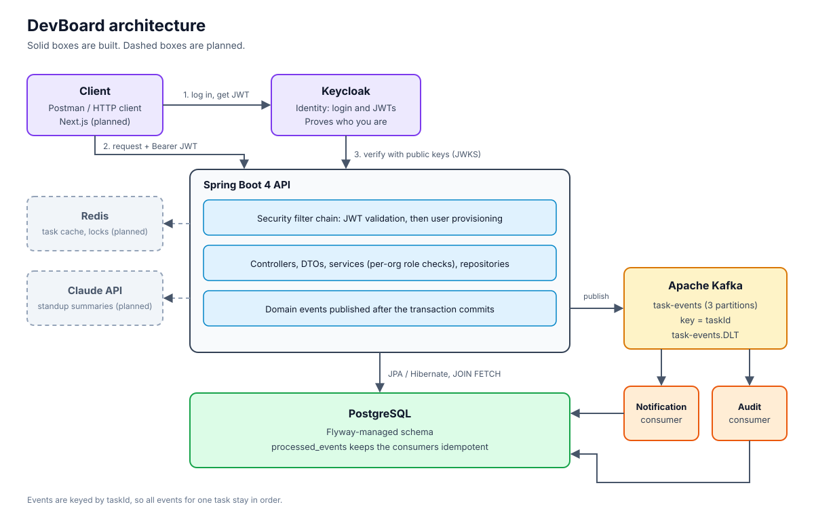
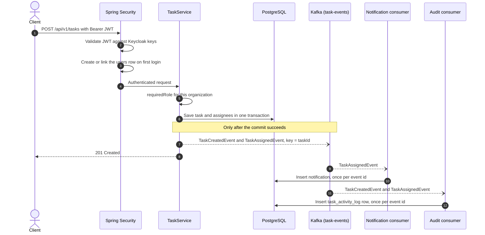
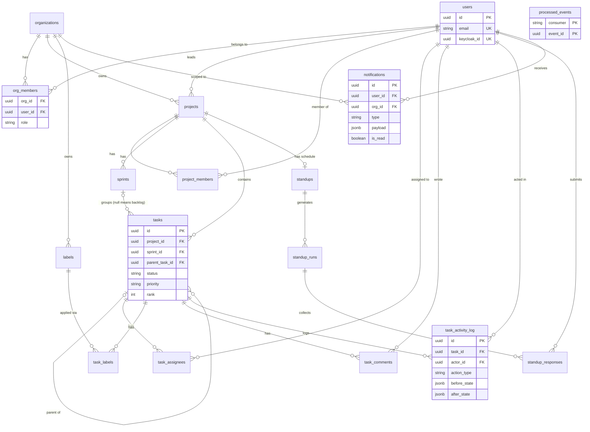

# DevBoard

A multi-tenant SaaS for engineering teams: sprint and task management, async standups, per-organization authorization, and a Kafka event layer. AI-written standup summaries are planned.


<p align="center">
  
</p>

**Status:** backend in active development. The frontend has not started. See [Status](#status) for what is built and what is planned.

## Why this project exists

I have two years of production full-stack work, mostly frontend-heavy. DevBoard is where I go deep on the backend side: multi-tenant data modeling, identity and authorization, and event-driven design. I picked a stack that is harder than what I already know and built the unglamorous layers first.

## Status

| Area | State |
|---|---|
| REST API for organizations, members, projects, sprints, tasks, labels, comments, standups, notifications | Built |
| Flyway migrations as the single source of truth for the schema | Built |
| Keycloak login, JWT validation, user provisioning on first login | Built |
| Per-organization role checks (`org_members`) in the service layer | Built |
| Kafka events with notification and audit consumers, idempotent, with a dead-letter topic | Built |
| Redis caching and the daily standup scheduler | Planned |
| AI standup summaries (Claude API) | Planned |
| Automated tests (Testcontainers), CI | Planned |
| Docker Compose for the full stack | Planned |
| OpenAPI documentation | Planned |
| Next.js frontend | Planned |

## Features

- **Organizations and membership.** Users can belong to several organizations with a different role in each (OWNER, EDITOR, MEMBER, VIEWER).
- **Projects, sprints, backlog.** A task with no sprint is in the backlog, so there is no separate backlog table.
- **Tasks.** Subtasks (one level), multiple assignees, labels, priority, status, story points, and server-managed ordering.
- **Comments and activity log.** Every meaningful task change becomes an audit row. The log is append-only, enforced by a database trigger.
- **Standups.** Per-project schedule, one run per day, one response per person per run. A blocker is detected automatically from the answer text.
- **Notifications.** Created from task events, with unread counts and mark-as-read.
- **Consistent errors.** Failures come back as RFC 7807 problem responses.

## Architecture

The diagram above shows the moving parts. The numbered path on the left is the login flow: the client gets a JWT from Keycloak, calls the API with it, and the API verifies the token against Keycloak's public keys without ever seeing a password.

### What happens when a task is created



## Data model

Key columns only. The full schema lives in [`src/main/resources/db/migration`](src/main/resources/db/migration).



`processed_events` is not linked to anything on purpose. It records which events each consumer has already handled.

## Security model

Identity and authorization are separate questions with separate owners.

| Question | Answered by | Where |
|---|---|---|
| Who are you? | Keycloak | The `sub` claim in the JWT |
| Which DevBoard account is that? | The `users` table | `users.keycloak_id`, created or linked on first login |
| What can you do in this organization? | The `org_members` table | `AuthorizationService.requiredRole(orgId, keycloakId, roles...)` |

A user can be OWNER of one organization and VIEWER of another, so a role in the token cannot express permissions. Every service method that touches organization data resolves the organization from the resource itself (never from the request body) and checks the caller's membership there.

First login creates the `users` row. If a row with the same email already exists, it is linked only when Keycloak reports `email_verified`, so nobody can claim another person's account by registering with their address.

## Event-driven design

- **One topic, ordered per task.** `task-events` has 3 partitions and the key is the task id, so events about one task are always read in order.
- **Publish after commit.** `TaskService` announces events inside its transaction. A `@TransactionalEventListener(AFTER_COMMIT)` sends them to Kafka, so a rolled-back transaction never produces an event.
- **Independent consumers.** `devboard-notifications` and `devboard-audit` are separate consumer groups. Each receives every event and tracks its own position. Adding a third consumer needs no change to `TaskService`.
- **Idempotent consumers.** Kafka delivers at least once. Each consumer inserts `(consumer, event_id)` into `processed_events` in the same transaction as its side effect, so a redelivered event is skipped. The primary key does the enforcing, not an `exists()` check.
- **Failures.** A failing event is retried a few times and then parked in `task-events.DLT`.

## Design decisions

| Decision | Reason |
|---|---|
| Keycloak for identity, `org_members` for authorization | Roles belong to a membership, not to a person |
| Response DTOs for every endpoint | Avoids lazy-loading errors, recursion, and leaking fields |
| `JOIN FETCH` and `@EntityGraph` on reads, `open-in-view=false` | Removes N+1 queries and stops lazy loading from hiding in the view layer |
| `@Transactional` on every service method | Keeps the session open for mapping and rolls back partial writes |
| Status and rank are set by the server | Two clients cannot collide on rank, and nobody can create a task that is already DONE |
| Junction tables instead of array columns | Keeps the schema in first normal form and lets a membership carry its own data |
| Unique constraints back every duplicate check | Application-level checks alone lose races under concurrency |
| Flyway for every schema change | The database and the entities cannot silently drift apart |

## Tech stack

| Layer | Technology |
|---|---|
| Language and framework | Java 17+ (developed on JDK 24), Spring Boot 4.1 |
| Persistence | Spring Data JPA, Hibernate 7, PostgreSQL 18, Flyway |
| Security | Spring Security OAuth2 resource server, Keycloak |
| Messaging | Apache Kafka, Spring Kafka |
| Build | Maven |
| Planned | Redis, Anthropic Claude API, Testcontainers, GitHub Actions, Docker Compose, Next.js |

## API overview

All endpoints live under `/api/v1` and require a Bearer token.

| Resource | What it covers |
|---|---|
| Organizations and members | Create, update, list members, change roles |
| Projects and project members | Lifecycle, lead, membership |
| Sprints | Planning and moving tasks between sprints and the backlog |
| Labels | Organization-wide labels |
| Tasks | CRUD, assignees, labels, subtasks. Listing by project, sprint, or backlog |
| Task comments and activity | Comments on a task, read-only audit history |
| Standups, runs, responses | Schedule, daily run, per-person answers |
| Notifications | List, unread count, mark as read |

An OpenAPI spec is planned.

## Running locally

Docker Compose for the full stack is planned. For now the infrastructure is started by hand.

**Prerequisites:** JDK 17 or newer, Docker, PostgreSQL, and a Keycloak server.

**1. PostgreSQL.** Create a database named `DevBoard`. Flyway creates the schema on startup.

**2. Kafka.**

```bash
docker run -d --name zookeeper -p 2181:2181 -e ZOOKEEPER_CLIENT_PORT=2181 -e ZOOKEEPER_TICK_TIME=2000 confluentinc/cp-zookeeper:7.5.0
docker run -d --name kafka -p 9092:9092 -e KAFKA_BROKER_ID=1 -e KAFKA_ZOOKEEPER_CONNECT=zookeeper:2181 -e KAFKA_ADVERTISED_LISTENERS=PLAINTEXT://localhost:9092 -e KAFKA_OFFSETS_TOPIC_REPLICATION_FACTOR=1 --link zookeeper confluentinc/cp-kafka:7.5.0
```

The application creates the topics itself on startup.

**3. Keycloak.** Run Keycloak, create a realm (this project uses `OAuth2-devboard`), and add a confidential client with **Client authentication** and **Direct access grants** turned on. Create a test user with an email and a password.

**4. Configuration.** Copy `.env.example` to `.env` and fill it in. `.env` is git-ignored.

```
DB_URL=jdbc:postgresql://localhost:5432/DevBoard
DB_USERNAME=postgres
DB_PASSWORD=change-me
KEYCLOAK_ISSUER_URI=http://127.0.0.1:8334/realms/OAuth2-devboard
```

**5. Run.**

```bash
./mvnw spring-boot:run        # Windows: mvnw.cmd spring-boot:run
```

**6. Call the API.** For local testing only, get a token with the password grant, then use it. Tokens expire after about five minutes.

```bash
TOKEN=$(curl -s -X POST "http://127.0.0.1:8334/realms/OAuth2-devboard/protocol/openid-connect/token" \
  -d grant_type=password -d client_id=<client-id> -d client_secret=<client-secret> \
  -d username=<user> -d password=<password> | jq -r .access_token)

curl -H "Authorization: Bearer $TOKEN" http://localhost:8080/api/v1/organizations
```

[//]: # (## Screenshots)

[//]: # ()
[//]: # (| | |)

[//]: # (|---|---|)

[//]: # (| ![Both consumer groups caught up]&#40;docs/images/kafka-consumer-groups.png&#41; | ![Publish then consume in the application log]&#40;docs/images/event-flow-logs.png&#41; |)

[//]: # (| Two consumer groups reading the same topic, lag 0 | One event published, then consumed, in the application log |)

[//]: # (| ![A cross-organization request is rejected]&#40;docs/images/cross-org-403.png&#41; | ![Flyway-managed tables in pgAdmin]&#40;docs/images/pgadmin-tables.png&#41; |)

[//]: # (| A user from another organization is rejected | Schema created and tracked by Flyway |)

## Project structure

```
src/main/java/com/satyam/DevBoard
├── config/        security, Kafka topics and error handling, Flyway
├── controller/    REST controllers
├── dto/           request and response objects
├── event/         domain event records
├── exception/     custom exceptions and the global handler
├── messaging/     Kafka publisher, consumers, processed-event store
├── model/         JPA entities
├── repository/    Spring Data repositories
├── security/      user provisioning filter
└── service/       business logic and authorization checks
src/main/resources/db/migration/   Flyway migrations
```

## Known limitations

- There are no automated tests yet. Testcontainers integration tests are the next quality milestone.
- Events are published after commit but without an outbox. If Kafka is unreachable at that exact moment, the event is lost.
- A malformed message can still stall a consumer. Wrapping the deserializer in `ErrorHandlingDeserializer` is not done yet.
- List endpoints are not paginated.
- Tenant isolation is enforced in application code. PostgreSQL row-level security is not used as a second layer.
- The password grant in the local-testing section is for development only.

## Roadmap

- [x] Domain model, REST API, global error handling
- [x] Flyway migrations
- [x] Keycloak authentication, per-organization authorization, user provisioning
- [x] Kafka event layer with idempotent consumers
- [ ] Redis caching for task lists, invalidated by Kafka events
- [ ] Daily standup scheduler with a distributed lock
- [ ] AI standup summaries
- [ ] Testcontainers integration tests and coverage
- [ ] Docker Compose and GitHub Actions
- [ ] OpenAPI documentation
- [ ] Next.js frontend

## About

Built by **Satyam Kalihari**, a final-year B.Tech Computer Science student at Symbiosis Institute of Technology, Nagpur. I am looking for internships and fresher roles in cloud-native backend and DevOps. I post weekly build notes on LinkedIn.

[GitHub](https://github.com/satyam-kalihari) · [LinkedIn](https://www.linkedin.com/in/satyam-kalihari-6234b0247/)
